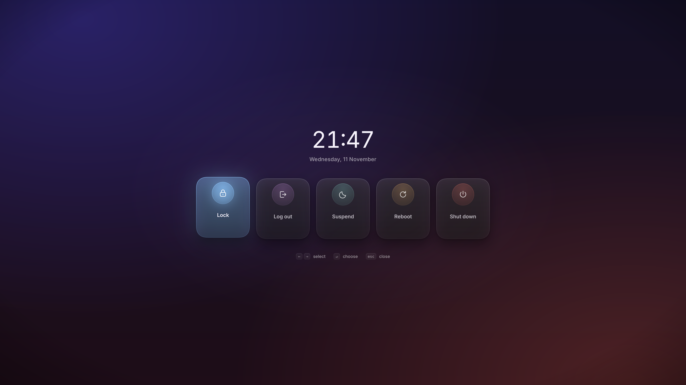
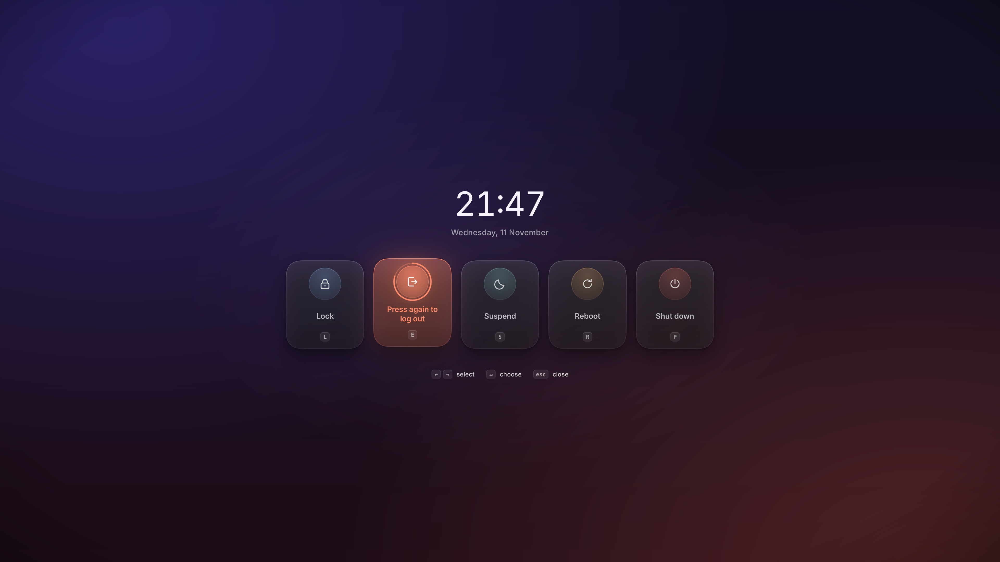
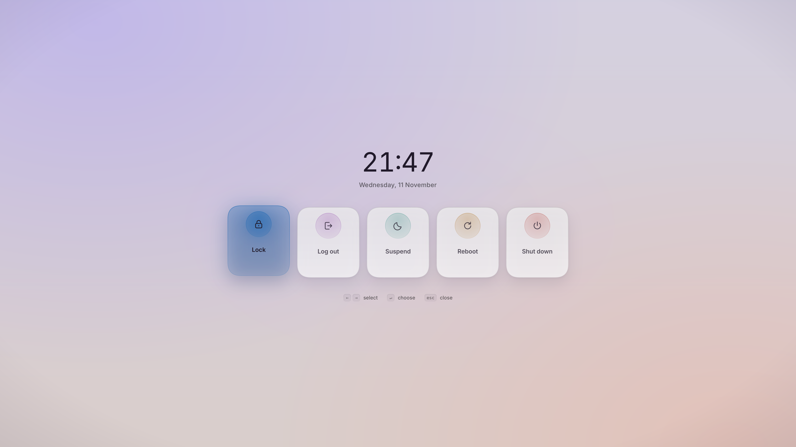
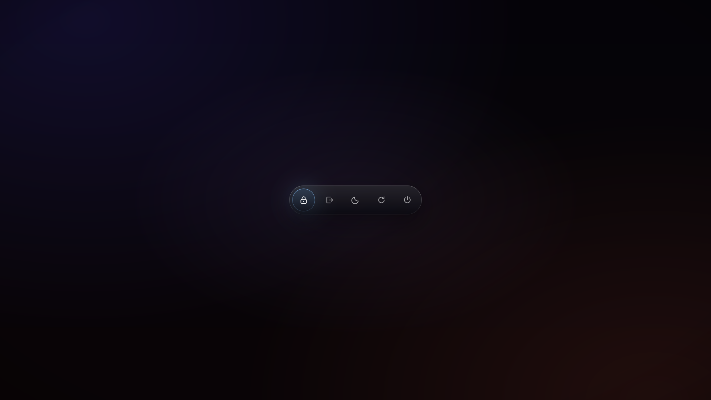
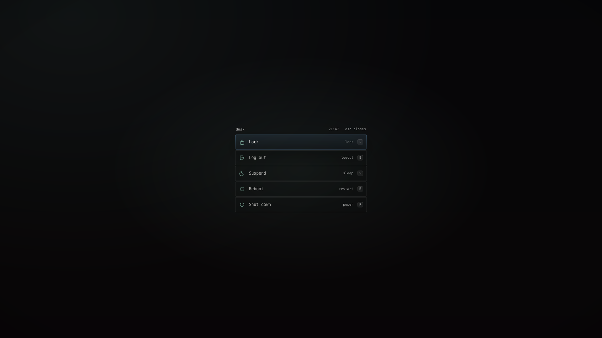
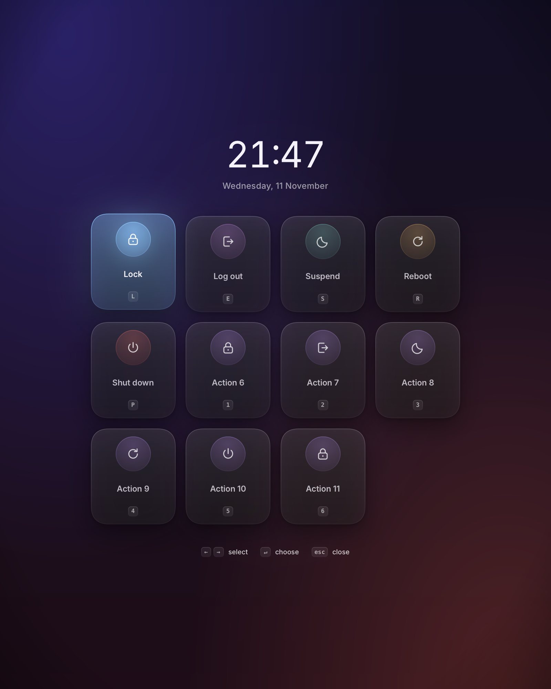

# dusk

A logout and power menu for Wayland compositors (Hyprland, Sway and Niri), drawn with [Rune](https://github.com/anomalyco/rune). It looks finished with no config, and changing it takes one readable `config.kdl`.



| Armed                                | Light                                | Halo                               |
| ------------------------------------ | ------------------------------------ | ---------------------------------- |
|  |  |  |

| Mono                               | A long list                                     |
| ---------------------------------- | ----------------------------------------------- |
|  |  |

## Why

**dusk** fixes what wlogout gets wrong: one config instead of JSON layout plus GTK CSS, typed tokens instead of CSS traps, validated settings with line numbers instead of a crash, case-insensitive mnemonics, one instance, a menu that closes before it runs a power action, and built-ins logind says this machine can actually do. It is a short-lived process: open, choose, exit.

## Install

Runtime dependencies: a Wayland session with `zwlr_layer_shell_v1` (Hyprland is the tested one; Sway and Niri are supported), `libxkbcommon`, `libwayland-client`, a Vulkan driver, Fontconfig, and systemd-logind. Icons and fonts are embedded. `notify-send` is used for failures when available.

Build dependencies (Arch): `rust` (1.95 or newer), `libxkbcommon`, `wayland`, `vulkan-icd-loader`, `fontconfig`, `pkg-config`.

From a checkout:

```sh
cargo build --release
sudo install -Dm755 target/release/dusk /usr/bin/dusk
```

Or let Cargo build and install it into `~/.cargo/bin`:

```sh
# latest tagged release
cargo install --git https://github.com/rodneyosodo/dusk --tag v0.1.2 --locked dusk

# main branch
cargo install --git https://github.com/rodneyosodo/dusk --branch main --locked dusk

# the checkout you are in
cargo install --path . --locked
```

Replace `v0.1.2` with the latest tag. `cargo install` fetches the pinned Rune fork commit, so it needs network access. Make sure `~/.cargo/bin` is on `PATH`.

Rune is pre-release and upstream does not take pull requests. dusk pins [the fork](https://github.com/rodneyosodo/rune) at commit `c2487b99` (tag `dusk-6ba947e5-focus-keymap`), which is upstream `dev` `6ba947e5` plus two Wayland layer-surface fixes. A clean build fetches that commit once; nothing is vendored in the repo. The fixes and the bump procedure are in [docs/RUNE-PATCH.md](docs/RUNE-PATCH.md).

### Compositor setup

Hyprland is the primary target. Sway and Niri get the same menu, focused-monitor targeting and default logout. Any other layer-shell compositor still draws the menu on the first display; set `run` on a logout action if it has no default.

#### Hyprland

Add a keybind. With Hyprland 0.57's Lua config:

```lua
hl.bind(mainMod .. " + Escape", hl.dsp.exec_cmd("dusk"))
```

With `hyprland.conf`:

```ini
bind = SUPER, Escape, exec, dusk
```

Add one line so Hyprland blurs the desktop behind the menu:

```lua
hl.layer_rule({ match = { namespace = "^dusk" }, blur = true, ignore_alpha = 0.02, no_anim = true })
```

In an older `hyprland.conf`:

```ini
layerrule = blur, ^dusk
layerrule = ignorealpha 0.02, ^dusk
layerrule = noanim, ^dusk
```

#### Sway

```ini
bindsym $mod+Escape exec dusk
```

Sway has no built-in layer blur, so dusk uses its denser veil; the theme is designed to read without blur.

#### Niri

```kdl
binds {
    Mod+Escape { spawn "dusk"; }
}

layer-rule {
    match namespace="^dusk$"
    background-effect {
        blur true
    }
}
```

`dusk doctor` checks the rule, the locker, and logind, and prints the snippet if it is missing. Without the rule, every theme still has enough tint and shadow to read.

While open, dusk closes when it loses keyboard focus, when logind locks the session, before the
machine sleeps, and when Hyprland's monitor set changes. Reopen it after plugging or unplugging a
display; the surfaces are rebuilt at launch.

A recovery bind is useful if a menu ever hangs:

```ini
bind = SUPER SHIFT, Escape, exec, pkill -x dusk
```

## Commands

```text
dusk                 open, or close if already open
dusk check [path]    report problems with line numbers; non-zero on failure
dusk preview [path]  live-reloading preview; actions only print
dusk doctor          layer-shell, blur rule, locker, logind capabilities
dusk init            write a commented starter config; print the compositor setup snippet
dusk --dry-run       the real menu, but actions only print
```

Rune's headless flags pass through: `--snap out.png`, `--scene armed`, `--tree tree.json`, `--script events.json --frames 120`, `--at 0.4`, `--size 1920x1080`, `--theme light`.

## Config

No config is needed. When there is one it lives at `~/.config/dusk/config.kdl` (or `$XDG_CONFIG_HOME/dusk/config.kdl`):

```kdl
theme "dusk"              // dusk, halo, mono, themes/<id>.kdl, or a path
layout "row"              // row, grid, list
appearance "auto"         // auto follows the system; light or dark overrides it

tokens {
    accent "#d38be0"
    radius 28
}
tokens "light" { dim "white/40" }

hide "hibernate"
order "lock" "logout" "suspend" "reboot" "shutdown"

// Change one field of a built-in; the rest keep their defaults.
action "logout" { run "hyprshutdown"; key "e" }

// Add your own.
action "firmware" {
    label "Firmware"
    icon "~/.config/dusk/icons/chip.svg"
    run "systemctl reboot --firmware-setup"
    key "f"
    confirm #true
}
```

The full token table is in [docs/THEMING.md](docs/THEMING.md).

## Safety

Shutdown, reboot and log out ask for a second press inside three seconds. Lock and suspend fire at once; each action can set `confirm #false`. Held keys, key repeat and a second press within 250 ms never count. Lock, suspend, reboot and poweroff appear only when logind allows them, and an inhibitor keeps the menu open with the blocker named. Surfaces are destroyed before a command is spawned, so a polkit prompt isn't hidden behind the menu.

Use `--dry-run`, `preview`, or a headless run while developing. They can never reach a real power action.

## Exit codes

| Code | Meaning                                               |
| ---- | ----------------------------------------------------- |
| 0    | success, closed, or toggled another instance          |
| 1    | `dusk check` found problems                           |
| 3    | no display / event loop / renderer failure            |
| 70   | watchdog: the menu stopped responding and was removed |

## Development

`docs/TESTING.md` has the headless scene set and manual matrix, `docs/THEMING.md` documents every token, and `docs/RUNE-PATCH.md` records the Rune fixes this build depends on.

```sh
cargo test
cargo clippy --all-targets -- -D warnings
cargo run -- --scene idle --snap /tmp/dusk.png --size 1920x1080
```

Development and tests only ever use `--dry-run`, `preview` or headless runs. Automated tests must never be able to reach a real power action.

## License

MIT. The bundled icons are drawn for dusk. Rune keeps its MIT license and copyright.
